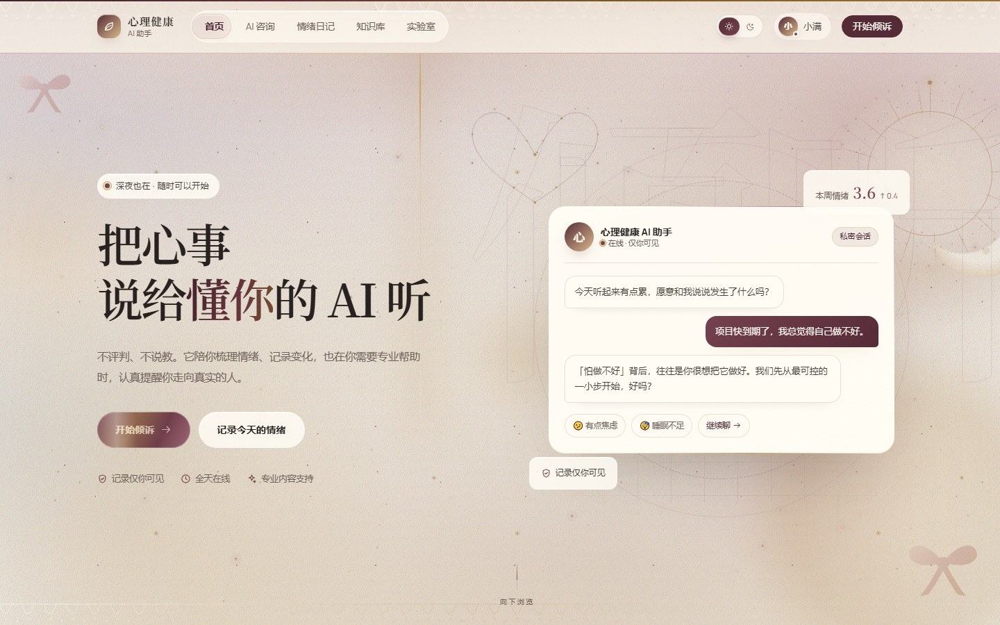
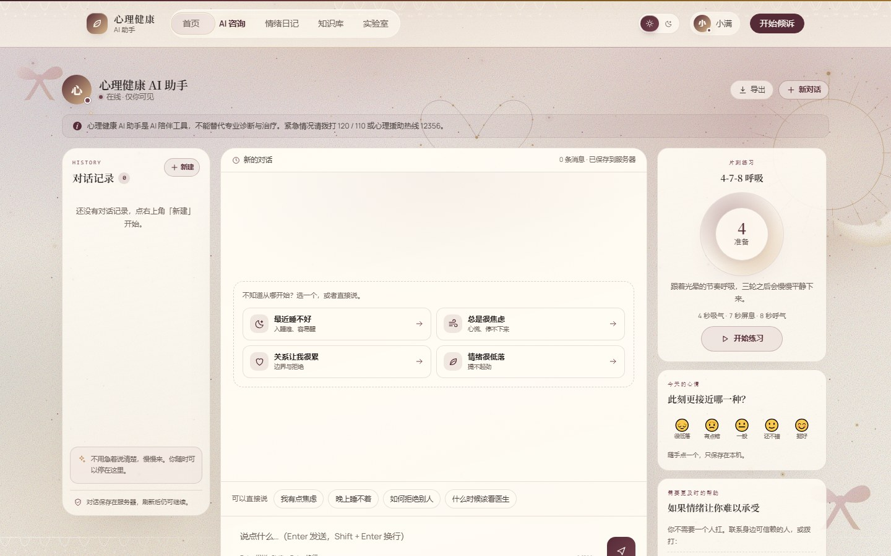
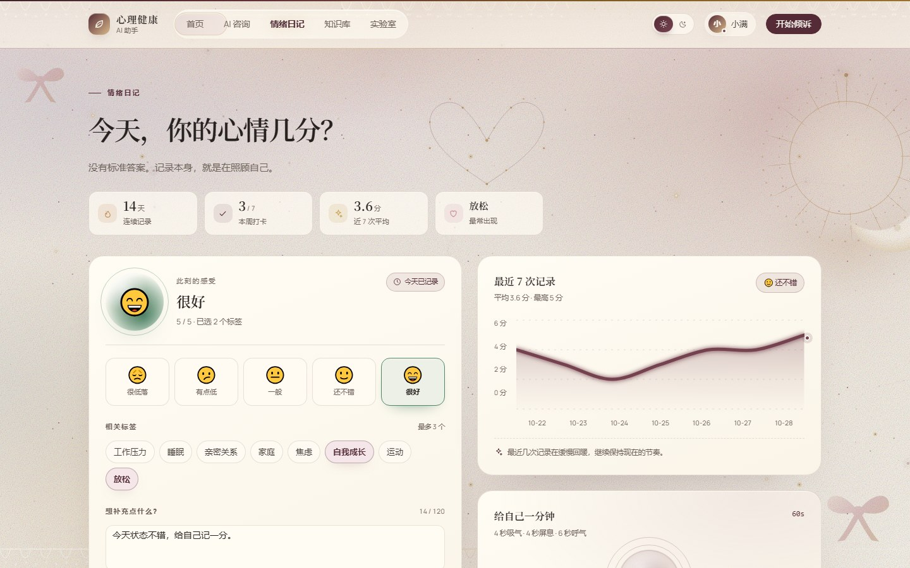
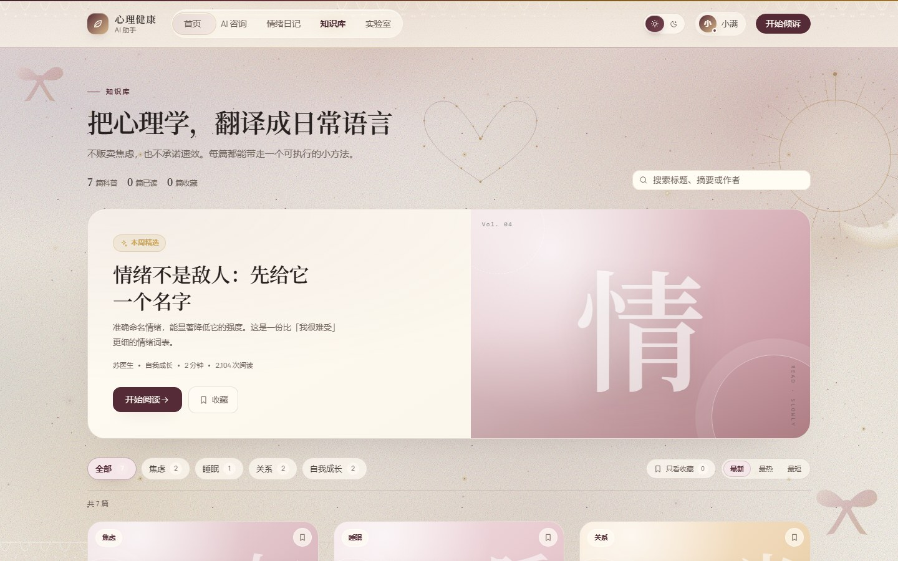

# AI 心理健康助手

这是两个练手项目的合集仓库：

- [`spring-ai-rag/`](spring-ai-rag/README.md)：Spring Boot 3 + Spring AI 的 RAG 知识库后端，带 JWT 鉴权、心理科普文章、情绪打卡、咨询记录与后台管理，存储使用 MySQL + Milvus + Redis。
- [`vue-element-app/`](vue-element-app/README.md)：Vue 3 + Vite + Element Plus 的前后台演示，包含前台（首页、AI 咨询、情绪日记、知识库）与运营后台（数据分析、知识文章、查询记录、情绪日志）。

## 目录结构

```text
AI心理健康助手/
├─ spring-ai-rag/     # Spring Boot + Spring AI + Milvus + MySQL
└─ vue-element-app/   # Vue 3 + Vite + Element Plus
```

## 界面预览

前台页面截图（使用 `front / front` 演示账号，连接后端 demo 数据）：

| 首页 | AI 咨询 |
| --- | --- |
|  |  |
| **情绪日记** | **知识库** |
|  |  |

## 快速开始

### vue-element-app

要求 Node.js 20+。

```bash
cd vue-element-app
npm install
npm run dev
```

- 前台演示账号：`front` / `front`
- 后台演示账号：`back` / `back`

更多说明见 [`vue-element-app/README.md`](vue-element-app/README.md)。

### spring-ai-rag

要求 JDK 17+、Maven 3.9+、MySQL 8；完整链路还需要 Redis 与 Milvus（或使用 `demo` / `local` profile 降级）。

```bash
cd spring-ai-rag
cp .env.example .env        # 填入模型网关等配置
mvn spring-boot:run -Dspring-boot.run.profiles=local
```

Windows 也可以复制 `run-local.ps1` 并把里面的 `<在此填入你自己的 API Key>` 替换成自己的 Key 后运行。

更多说明见 [`spring-ai-rag/README.md`](spring-ai-rag/README.md)。

## 安全说明

以下文件包含本地密钥或本机配置，已被 `.gitignore` 排除，不会提交到仓库：

- `spring-ai-rag/.env`
- `spring-ai-rag/run-local.ps1`
- `spring-ai-rag/src/main/resources/application-local.yml`

克隆后请从 `.env.example` 复制出自己的 `.env`，不要把真实 API Key 提交到 GitHub。
