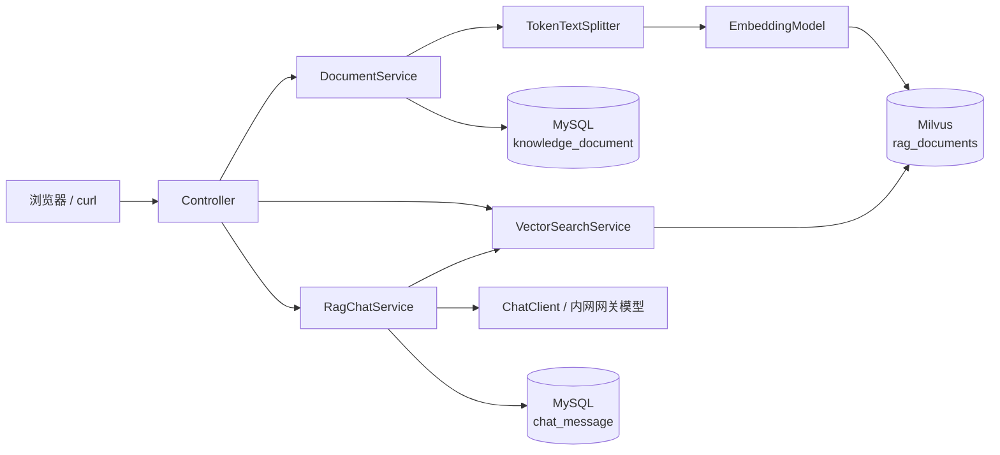

# Spring AI RAG 知识库（Spring Boot + Spring AI + Milvus + MySQL）

一个可直接运行的检索增强生成（RAG）练手项目：把文本 / Markdown 文件写入知识库，按语义检索片段，再让大模型**只依据检索结果**回答问题。

- 业务库：MySQL 8（文档原文、会话历史）
- 向量库：Milvus 2.5 standalone（chunk 向量 + 元数据）
- 对话模型：内网网关 `http://your-gateway.example.com`（OpenAI 兼容协议，模型 `deepseek-v4-flash`）
- Embedding：任意 OpenAI 兼容接口（默认硅基流动 `BAAI/bge-m3`，1024 维）
- 框架：Spring Boot 3.5.16 + Spring AI 1.1.8（BOM 管理）+ Maven

> 没有 Docker / 没有 API Key 也能先跑：`demo` profile 使用 H2 内存库 + `SimpleVectorStore` + 本地哈希 Embedding，自动写入示例数据，链路完整可体验。登录鉴权使用 JWT + Redis，需要本机先启动 Redis（默认 `localhost:6379`）。

---

## 1. 功能

| 能力 | 说明 |
| --- | --- |
| 文档入库 | `POST /api/documents` 文本入库、`POST /api/documents/upload` 上传 `.txt/.md`；原文存 MySQL，`TokenTextSplitter` 切块后向量化写入 Milvus |
| 语义检索 | `POST /api/search` 返回 chunk、相似度、标题 |
| RAG 问答 | `POST /api/chat` 检索 topK 片段 → 拼提示词 → 调用内网网关模型 → 返回回答 + 参考资料；多轮历史存 MySQL |
| 文档删除 | `DELETE /api/documents/{id}` 先删 Milvus 向量再删 MySQL 记录，避免脏向量 |
| 会话管理 | 查询 / 删除会话历史 |
| 登录鉴权 | `POST /api/auth/login` 签发 JWT；Redis 保存会话，支持注销、停用即时失效与在线人数统计 |
| 用户管理 | 后台账号增删改查、角色切换、启停用与密码重置，停用/改密后旧令牌立即失效 |
| 个人资料 | 当前用户查看/修改姓名与身份、修改密码；改密后其他设备自动退出 |
| 前台业务 | 科普文章列表/详情、每日情绪打卡（按用户隔离，同一天覆盖更新） |
| 后台业务 | 仪表盘聚合、文章增删改与上下线、咨询记录详情/跟进、全量情绪日志审查 |
| 可观测性 | `/api/meta` 查看当前向量库、模型与文档数；Swagger UI；内置测试页 `static/index.html` |
| 工程化 | 参数校验、统一 `ProblemDetail` 异常、H2 集成测试、docker-compose |

## 2. 架构



- MySQL 存**原文**和**会话**；Milvus 存**chunk 向量**和元数据（`docId`、`title`、`chunkIndex`）。
- 登录会话存 Redis：JWT 携带身份，Redis 决定令牌是否仍然有效，注销 / 停用 / 改密可以即时生效。
- 每个 chunk 的向量 id 固定为 `docId:chunkIndex`，并记录在 `knowledge_document.vector_ids`，删除文档时可精确清理向量。
- 检索用问题向量在 Milvus 做余弦相似度搜索，取 topK 后拼进提示词，由模型生成带引用编号的回答。

## 3. 目录结构

```text
spring-ai-rag
├─ pom.xml
├─ docker-compose.yml          # MySQL + etcd + MinIO + Milvus + Attu
├─ .env.example                # 环境变量示例
├─ run-local.ps1               # 本地一键启动 demo（含 token，已 gitignore）
├─ src/main/java/com/example/rag
│  ├─ SpringAiRagApplication.java
│  ├─ config/                  # RagProperties、ChatClient、demo 配置与示例数据
│  ├─ domain/                  # 用户、文章、情绪、咨询、知识文档、聊天消息（JPA 实体）
│  ├─ repository/              # Spring Data JPA
│  ├─ service/                 # 鉴权、用户、资料、文章、情绪、咨询、仪表盘、入库/检索/RAG
│  ├─ support/                 # 本地哈希 Embedding、业务异常
│  └─ web/                     # Controller、DTO、统一异常处理
└─ src/main/resources
   ├─ application.yml          # 基础配置：MySQL + Milvus（无 profile 时叠加 local）
   ├─ application-demo.yml     # 无依赖演示配置
   └─ static/index.html        # 内置测试页
```

## 4. 快速开始（真实 MySQL + Milvus）

### 4.0 最快跑通：本机 MySQL + 内存向量库（无需 Docker）

如果只是想先把前后端跑起来看效果，可以跳过 Milvus，用 `local` profile：

> 无论用哪个 profile，登录鉴权都依赖 Redis，请先确保本机 Redis 已启动（默认 `localhost:6379`）；也可以执行 `docker compose up -d redis`，再把 `REDIS_PORT` 设为 `16379`。

1. 确认本机 MySQL 8 已启动，创建数据库（默认账号 `root` / `123456`，可在 `application-local.yml` 或环境变量里改）：

   ```sql
   CREATE DATABASE IF NOT EXISTS springai_rag DEFAULT CHARACTER SET utf8mb4 COLLATE utf8mb4_unicode_ci;
   ```

2. 启动后端（数据落 MySQL；向量用内存 `SimpleVectorStore`，重启时自动从 MySQL 重建索引）：

   - **IDEA 里直接点 Run 即可**：没有显式 profile 时默认就是 `local`，网关 token 会从项目根目录 `.env` 读取（可从 `.env.example` 复制并填写）。数据库默认 `root / 123456`，不一致时改 `application-local.yml` 或环境变量。
   - 命令行：

     ```powershell
     .\run-local.ps1
     # 或者
     mvn spring-boot:run
     ```

3. 启动前端：

   ```bash
   cd ../vue-element-app
   npm install
   npm run dev
   ```

4. 打开 <http://localhost:5173/login>：
   - 前台账号 `front` / `front` → 首页、AI 咨询（流式对话 + 知识库引用）、心理科普、情绪日记、个人资料；
   - 后台账号 `back` / `back` → 数据分析、用户管理、知识文章、RAG 知识库、咨询记录、情绪日志、个人资料；
   - 登录态由 JWT + Redis 维护，刷新页面不会掉线；退出登录、账号停用或改密后旧令牌立即失效。

前端通过 Vite proxy 把 `/api` 转发到 `http://127.0.0.1:8080`，无需处理跨域。

> 想切到 MySQL + Milvus，并直接用 Attu 查看向量数据：
> `.\start-milvus.ps1` 启动向量库，再用 `.\run-milvus.ps1` 或
> `java -jar target/spring-ai-rag-0.0.1-SNAPSHOT.jar --spring.profiles.active=milvus` 启动后端。
> 这个 profile 使用 WSL 内的 Docker Engine + 本地哈希 Embedding，不需要额外的 Embedding Key。
> 详细步骤和 Attu 连接参数见 4.0。

### 4.0 本机现成方案：WSL + Docker + Milvus + Attu

本机已经装好 **WSL2 Ubuntu-24.04 内的 Docker Engine**（不需要 Docker Desktop，也不用重启），
Milvus、etcd、MinIO、Attu 四个容器由 `docker-compose-milvus.yml` 管理，数据保存在
WSL 的 `/opt/rag/volumes`，重启后仍在。

```powershell
# 项目根目录
.\start-milvus.ps1      # 启动 Docker + Milvus + Attu，并等待 healthy

# 另开一个窗口启动后端（milvus profile）
.\run-milvus.ps1
# 或者
java -jar spring-ai-rag\target\spring-ai-rag-0.0.1-SNAPSHOT.jar --spring.profiles.active=milvus
```

打开 <http://localhost:8000> 进入 Attu，连接参数：

| 字段 | 值 |
| --- | --- |
| Milvus Address | `milvus:19530`（Attu 容器内部地址，**不要填 localhost**） |
| Username | `root` |
| Password | `Milvus` |
| Database | `default` |

连接后左侧选择 `default` 数据库，即可看到集合 **`rag_documents`**：
6 条向量、维度 1024、索引 `IVF_FLAT`、度量 `COSINE`，点进集合可浏览 `doc_id` / `content` / `metadata` / `embedding` 字段。

> `milvus` profile 使用本地哈希 Embedding，不依赖在线 Embedding Key；知识库文档仍持久化在本机 MySQL。
> 想用真实语义 Embedding 时，用基础配置 `default` + `EMBEDDING_API_KEY`（见 4.2~4.4）。

### 4.1 前置条件

- JDK 17+、Maven 3.9+
- **Docker Engine**：本机已装在 WSL2 的 Ubuntu-24.04 内；也可以使用 Docker Desktop
  （Milvus standalone 依赖 etcd 与 MinIO，不能只起一个容器）
- 可访问内网模型网关 `http://your-gateway.example.com`，并拿到 token（这个网关同时兼容 Anthropic / OpenAI 协议）
- 可选：一个 OpenAI 兼容的 Embedding 服务，例如硅基流动（<https://siliconflow.cn>）的 `BAAI/bge-m3`
  - 只有 `default` profile 需要；`milvus` profile 用本地哈希 Embedding
  - 网关只负责对话，Embedding 要单独配置；两者用不同的 Key 和 base-url

### 4.2 启动 MySQL 与 Milvus

```bash
docker compose up -d
docker compose ps
```

| 服务 | 端口 | 说明 |
| --- | --- | --- |
| mysql | `13306:3306` | 本机可能已有 MySQL 占用 3306，因此映射到 13306；库名 `springai_rag` |
| milvus | `19530` / `9091` | gRPC / 健康检查 |
| attu | <http://localhost:8000> | Milvus 可视化界面（可选）；连接地址填 `milvus:19530`，账号 `root` / `Milvus` |
| minio | `9001` | 对象存储控制台（admin/minioadmin） |

首次拉镜像 + Milvus 启动大约 1~3 分钟，`curl http://localhost:9091/healthz` 返回 `OK` 即就绪。

> 已有 MySQL 8 时，可以把 compose 里的 `mysql` 服务整段注释，直接复用本机实例。

### 4.3 创建数据库（仅使用本机 MySQL 时需要）

```sql
CREATE DATABASE IF NOT EXISTS springai_rag DEFAULT CHARACTER SET utf8mb4 COLLATE utf8mb4_0900_ai_ci;
```

表结构由 Hibernate `ddl-auto=update` 自动创建（见第 8 节）。

### 4.4 设置环境变量（Windows PowerShell）

```powershell
# 对话：内网网关（沿用你现有的 ANTHROPIC_* 变量名）
$env:ANTHROPIC_AUTH_TOKEN = "sk-xxxxxxxx"
# 可选，默认就是这两个值
$env:ANTHROPIC_BASE_URL = "http://your-gateway.example.com"
$env:ANTHROPIC_MODEL = "deepseek-v4-flash"

# Embedding：独立服务
$env:EMBEDDING_API_KEY = "sk-xxxxxxxx"
# 使用 docker compose 的 MySQL 时，端口改为 13306
$env:MYSQL_PORT = "13306"
```

Bash / macOS：

```bash
export ANTHROPIC_AUTH_TOKEN=sk-xxxxxxxx
export EMBEDDING_API_KEY=sk-xxxxxxxx
export MYSQL_PORT=13306
```

> 如果只跑 demo（第 5 节），可以只设置 `ANTHROPIC_AUTH_TOKEN`。
> 项目根目录还提供了一个 `run-local.ps1`（已加入 `.gitignore`），里面预置了网关 token，双击/右键运行即可启动 demo。

### 4.5 启动应用

```bash
mvn spring-boot:run
```

- 测试页：<http://localhost:8080/>
- Swagger UI：<http://localhost:8080/swagger-ui.html>
- OpenAPI JSON：<http://localhost:8080/v3/api-docs>

### 4.6 用 curl 体验

```bash
# 1) 文本入库
curl -X POST http://localhost:8080/api/documents \
  -H "Content-Type: application/json" \
  -d '{
        "title": "Spring AI 技术栈说明",
        "source": "internal-wiki",
        "content": "本项目使用 Spring Boot 3.5、Spring AI 1.1、Milvus 向量数据库和 MySQL。文本经切块和 Embedding 后写入 Milvus，检索时按余弦相似度返回 topK 片段。"
      }'

# 2) 上传 Markdown 文件
curl -X POST http://localhost:8080/api/documents/upload \
  -F "file=@./README.md" \
  -F "title=README"

# 3) 语义检索
curl -X POST http://localhost:8080/api/search \
  -H "Content-Type: application/json" \
  -d '{"query":"向量数据库用的什么？","topK":5}'

# 4) RAG 问答（conversationId 留空会自动生成）
curl -X POST http://localhost:8080/api/chat \
  -H "Content-Type: application/json" \
  -d '{"question":"这个项目用了哪些技术？"}'

# 5) 查看会话历史
curl http://localhost:8080/api/chat/<conversationId>/messages
```

PowerShell 中 `curl` 是 `Invoke-WebRequest` 别名，可改用原生 `curl.exe`，或：

```powershell
Invoke-RestMethod -Method Post -Uri http://localhost:8080/api/search `
  -ContentType 'application/json' `
  -Body '{"query":"向量数据库用的什么？","topK":5}'
```

## 5. 无需 MySQL / Milvus 的演示（demo profile）

```bash
mvn spring-boot:run -Dspring-boot.run.profiles=demo
```

| 组件 | demo 中的实现 |
| --- | --- |
| 数据库 | H2 内存库（MySQL 兼容模式） |
| 登录会话 | JWT + 本机 Redis（默认 `localhost:6379`） |
| 向量库 | `SimpleVectorStore`（JVM 内存） |
| Embedding | `HashingEmbeddingModel`（分词 + 哈希 + L2 归一化，1024 维） |
| 示例数据 | 启动时自动写入演示账号、文章、咨询与情绪记录；`rag.demo.seed=false` 可关闭 |

说明：

- 需要先启动本机 Redis；也可以执行 `docker compose up -d redis`，此时把 `REDIS_PORT` 设为 `16379`；
- 无需安装 MySQL / Docker / Milvus，**入库、检索、删除**全流程可跑通；
- `/api/chat` 仍会调用内网网关，需要设置 `ANTHROPIC_AUTH_TOKEN`（demo 下默认占位符 `demo-key`，调用会 401/502）；
- 哈希 Embedding 只保证字面相近的文本向量相近，**不代表语义**，生产请换真实模型；
- 演示账号（首次启动自动写入，已存在则跳过）：

  | 账号 | 密码 | 角色 | 说明 |
  | --- | --- | --- | --- |
  | `front` | `front` | front | 小满 · 前台来访者 |
  | `back` | `back` | back | 林医生 · 后台管理员 |
  | `chenyu` | `demo123` | front | 陈雨 · 前台来访者 |
  | `sunlan` | `demo123` | back | 孙岚 · 后台咨询师 |
  | `zhouyu` | `demo123` | front | 周予 · 已停用示例 |

  被停用的账号登录会返回 401；启动时控制台会打印写入的示例账号、文章、咨询与情绪记录数量。
- 数据在重启后丢失，仅用于体验。

## 6. 配置项

### 6.1 环境变量

| 变量 | 默认值 | 说明 |
| --- | --- | --- |
| `MYSQL_HOST` / `MYSQL_PORT` | `localhost` / `3306` | MySQL 地址（用 compose 时端口为 `13306`） |
| `MYSQL_DATABASE` | `springai_rag` | 库名 |
| `MYSQL_USERNAME` / `MYSQL_PASSWORD` | `root` / `root` | 账号密码（`local` profile 默认密码为 `123456`） |
| `ANTHROPIC_AUTH_TOKEN` | 空 | **必填**，内网模型网关 token |
| `ANTHROPIC_BASE_URL` | `http://your-gateway.example.com` | 网关地址（走 OpenAI 兼容协议） |
| `ANTHROPIC_MODEL` | `deepseek-v4-flash` | 对话模型名 |
| `CHAT_MAX_TOKENS` | `2048` | 单次回答最大 token 数 |
| `EMBEDDING_API_KEY` | 空 | **必填**，Embedding 服务 Key |
| `EMBEDDING_BASE_URL` | `https://api.siliconflow.cn` | Embedding 服务地址 |
| `EMBEDDING_MODEL` | `BAAI/bge-m3` | Embedding 模型 |
| `EMBEDDING_DIMENSION` | `1024` | **必须与模型输出维度一致** |
| `MILVUS_HOST` / `MILVUS_PORT` | `localhost` / `19530` | Milvus 地址 |
| `MILVUS_USERNAME` / `MILVUS_PASSWORD` | `root` / `Milvus` | Milvus 账号（未开启鉴权时忽略） |
| `MILVUS_DATABASE` | `default` | Milvus 数据库名 |
| `REDIS_HOST` / `REDIS_PORT` | `localhost` / `6379` | Redis 地址（用 compose 时端口为 `16379`） |
| `REDIS_PASSWORD` / `REDIS_DATABASE` | 空 / `0` | Redis 密码与库号 |
| `JWT_SECRET` | 演示密钥 | **生产必改**，至少 32 字节 |
| `JWT_TTL` | `7d` | 登录令牌有效期 |
| `AUTH_ONLINE_WINDOW` | `15m` | 仪表盘在线人数统计窗口 |

### 6.2 rag.* 业务参数

| 配置 | 默认 | 说明 |
| --- | --- | --- |
| `rag.top-k` | 5 | 默认检索片段数 |
| `rag.similarity-threshold` | 0.35 | 相似度阈值（cosine，越大越严格） |
| `rag.max-context-chars` | 4000 | 拼进提示词的上下文字符上限 |
| `rag.chunk-size` | 500 | 切块 token 数 |
| `rag.history-window` | 6 | 多轮对话带入的历史消息条数 |

### 6.3 换一个 Embedding 服务

阿里百炼（OpenAI 兼容模式）：

```powershell
$env:EMBEDDING_BASE_URL = "https://dashscope.aliyuncs.com/compatible-mode"
$env:EMBEDDING_MODEL = "text-embedding-v3"
$env:EMBEDDING_DIMENSION = "1024"
```

> 换模型后维度会变化，必须同步修改 `EMBEDDING_DIMENSION`；Milvus 集合已按旧维度创建时需要先删除 `rag_documents` 集合（Attu 中删除，或调大版本号改用新 collection 名）。

## 7. API 一览

所有需要登录的接口统一使用请求头 `Authorization: Bearer <JWT>`。

### 7.1 登录与个人资料

| 方法 | 路径 | 权限 | 说明 |
| --- | --- | --- | --- |
| `POST` | `/api/auth/login` | 公开 | 账号密码登录，返回令牌与用户信息；停用账号返回 401 |
| `GET` | `/api/auth/me` | 登录 | 当前登录用户（校验令牌与 Redis 会话） |
| `POST` | `/api/auth/logout` | 登录 | 注销当前令牌，返回 204 |
| `GET` | `/api/profile` | 登录 | 个人资料 + 情绪记录数 + 咨询会话数 |
| `PUT` | `/api/profile` | 登录 | 修改姓名、身份（`name` / `title`） |
| `POST` | `/api/profile/password` | 登录 | 修改密码；成功后其他设备的令牌全部失效，当前设备保留 |

### 7.2 前台业务

文章接口公开；情绪记录接口需要登录，只读写当前用户自己的数据。

| 方法 | 路径 | 说明 |
| --- | --- | --- |
| `GET` | `/api/articles?category=&keyword=&sort=` | 已发布文章列表 |
| `GET` | `/api/articles/{id}` | 文章详情（阅读量 +1） |
| `GET` | `/api/moods` | 当前用户的情绪记录 |
| `POST` | `/api/moods` | 保存某天情绪（同一天覆盖更新） |
| `DELETE` | `/api/moods/{id}` | 删除自己的某条情绪记录 |

### 7.3 后台业务（back 账号）

| 方法 | 路径 | 说明 |
| --- | --- | --- |
| `GET` | `/api/admin/dashboard` | 仪表盘指标与趋势（真实数据聚合） |
| `GET` | `/api/admin/users?keyword=&role=` | 用户列表（支持账号/姓名/身份搜索与角色筛选） |
| `POST` | `/api/admin/users` | 新建用户：`{account, password, name, title, role, enabled?}` |
| `PUT` | `/api/admin/users/{id}` | 编辑用户（密码可留空表示不修改） |
| `POST` | `/api/admin/users/{id}/status` | 启用/停用：`{enabled}` |
| `DELETE` | `/api/admin/users/{id}` | 删除用户 |
| `GET` | `/api/admin/articles` | 全部文章（含草稿） |
| `POST` | `/api/admin/articles` | 新建文章 |
| `PUT` | `/api/admin/articles/{id}` | 编辑文章 |
| `POST` | `/api/admin/articles/{id}/status` | 上下线：`{status}` |
| `DELETE` | `/api/admin/articles/{id}` | 删除文章 |
| `GET` | `/api/admin/consultations` | 咨询记录列表 |
| `GET` | `/api/admin/consultations/{id}` | 咨询记录详情 |
| `POST` | `/api/admin/consultations/{id}/follow-up` | 标记为已跟进（状态置为已结束） |
| `GET` | `/api/admin/moods` | 全部用户情绪记录 |
| `DELETE` | `/api/admin/moods/{id}` | 删除任意情绪记录 |

### 7.4 RAG 知识库与检索

| 方法 | 路径 | 说明 |
| --- | --- | --- |
| `POST` | `/api/documents` | 文本入库：`{title, source, content}` |
| `POST` | `/api/documents/upload` | 文件入库（multipart：`file`、可选 `title`） |
| `GET` | `/api/documents` | 文档列表 |
| `GET` | `/api/documents/{id}` | 文档详情（含原文） |
| `DELETE` | `/api/documents/{id}` | 删除文档及其向量 |
| `POST` | `/api/search` | 语义检索：`{query, topK?, similarityThreshold?}` |
| `POST` | `/api/chat` | RAG 问答：`{conversationId?, question}` |
| `POST` | `/api/chat/stream` | 流式问答（SSE），事件：`meta` / `delta` / `done` / `error` |
| `POST` | `/api/chat/{conversationId}/regenerate/stream` | 重新生成最后一条回复（SSE） |
| `GET` | `/api/chat/conversations` | 对话记录列表（标题、最后一条、消息数） |
| `GET` | `/api/chat/{conversationId}/messages` | 会话历史 |
| `DELETE` | `/api/chat/{conversationId}` | 删除会话历史 |
| `GET` | `/api/meta` | 当前向量库 / 模型 / 文档数 / 向量块数 / 会话数 |

> 说明：`/api/documents`、`/api/search`、`/api/chat` 与 `/api/meta` 当前未强制登录，由前端布局控制入口；生产部署建议给文档写操作补上 `requireBack`，避免匿名调用。

问答响应示例：

```json
{
  "conversationId": "8f1c…",
  "answer": "根据资料，本项目使用 Spring Boot 3.5、Spring AI 1.1、Milvus 和 MySQL [资料1]。",
  "references": [
    {
      "chunkId": "1:0",
      "docId": 1,
      "title": "Spring AI 技术栈说明",
      "chunkIndex": 0,
      "score": 0.8312,
      "text": "本项目使用 Spring Boot 3.5、Spring AI 1.1…"
    }
  ]
}
```

SSE 流式响应示例（`Content-Type: text/event-stream`）：

```text
event:meta
data:{"conversationId":"8f1c…","references":[{"chunkId":"1:0","title":"…"}]}

event:delta
data:{"text":"先"}

event:done
data:{"conversationId":"8f1c…","messageId":42}
```

前端拿到 `meta` 后立即显示知识库依据，`delta` 追加到气泡，`done` 时刷新左侧对话列表；若模型报错会收到 `event:error`。

错误统一返回 RFC 9457 `application/problem+json`，例如：

```json
{ "type": "about:blank", "title": "参数校验失败", "status": 400, "detail": "title: title 不能为空" }
```

## 8. 数据表

由 Hibernate `ddl-auto=update` 自动创建（demo 使用 H2 内存库，重启即重建并重新写入示例数据）。核心表如下：

```sql
CREATE TABLE user_account (
  id            BIGINT       NOT NULL AUTO_INCREMENT,
  account       VARCHAR(64)  NOT NULL UNIQUE,   -- 登录账号
  password      VARCHAR(128) NOT NULL,          -- 演示项目明文存储，生产请改为 BCrypt
  name          VARCHAR(64)  NOT NULL,
  title         VARCHAR(64)  NOT NULL,
  role          VARCHAR(16)  NOT NULL,          -- front / back
  enabled       BOOLEAN      NOT NULL DEFAULT TRUE,
  last_login_at DATETIME(6),
  created_at    DATETIME(6)  NOT NULL,
  PRIMARY KEY (id)
) ENGINE = InnoDB DEFAULT CHARSET = utf8mb4;

CREATE TABLE article (
  id           BIGINT       NOT NULL AUTO_INCREMENT,
  title        VARCHAR(200) NOT NULL,
  category     VARCHAR(32)  NOT NULL,
  author       VARCHAR(64)  NOT NULL,
  summary      VARCHAR(500) NOT NULL,
  content      TEXT         NOT NULL,
  minutes      INT          NOT NULL,
  views        BIGINT       NOT NULL,
  status       VARCHAR(16)  NOT NULL,           -- 已发布 / 草稿
  cover        VARCHAR(16)  NOT NULL,           -- teal / lilac / sand
  published_at DATE,
  updated_at   DATE         NOT NULL,
  created_at   DATETIME(6)  NOT NULL,
  PRIMARY KEY (id)
) ENGINE = InnoDB DEFAULT CHARSET = utf8mb4;

CREATE TABLE mood_log (
  id         BIGINT       NOT NULL AUTO_INCREMENT,
  user_id    BIGINT,                            -- 登录账号 id；历史匿名数据可为空
  user_name  VARCHAR(64)  NOT NULL,
  initials   VARCHAR(8)   NOT NULL,
  tone       VARCHAR(16)  NOT NULL,
  session_id VARCHAR(64)  NOT NULL,
  mood_date  DATE         NOT NULL,
  score      INT          NOT NULL,             -- 1~5
  tags       VARCHAR(500),                      -- 逗号分隔
  note       TEXT,
  created_at DATETIME(6)  NOT NULL,
  updated_at DATETIME(6)  NOT NULL,
  PRIMARY KEY (id),
  KEY idx_mood_log_user_date (user_id, mood_date),
  KEY idx_mood_log_date (mood_date)
) ENGINE = InnoDB DEFAULT CHARSET = utf8mb4;

CREATE TABLE consultation (
  id            VARCHAR(32) NOT NULL,           -- C-1024 形式的业务编号
  user_name     VARCHAR(64) NOT NULL,
  initials      VARCHAR(8)  NOT NULL,
  tone          VARCHAR(16) NOT NULL,
  started_at    DATETIME(6) NOT NULL,
  duration      INT         NOT NULL,
  topic         VARCHAR(64) NOT NULL,
  status        VARCHAR(16) NOT NULL,           -- 进行中 / 已结束 / 待跟进
  risk          VARCHAR(16) NOT NULL,
  mood          VARCHAR(16) NOT NULL,
  message_count INT         NOT NULL,
  PRIMARY KEY (id)
) ENGINE = InnoDB DEFAULT CHARSET = utf8mb4;

CREATE TABLE consultation_message (
  id              BIGINT      NOT NULL AUTO_INCREMENT,
  consultation_id VARCHAR(32) NOT NULL,
  role            VARCHAR(16) NOT NULL,
  text            TEXT        NOT NULL,
  time_label      VARCHAR(8)  NOT NULL,
  PRIMARY KEY (id),
  KEY idx_consultation_message_consultation (consultation_id),
  CONSTRAINT fk_consultation_message_consultation
    FOREIGN KEY (consultation_id) REFERENCES consultation (id)
) ENGINE = InnoDB DEFAULT CHARSET = utf8mb4;

CREATE TABLE knowledge_document (
  id          BIGINT       NOT NULL AUTO_INCREMENT,
  title       VARCHAR(200) NOT NULL,
  source      VARCHAR(500),
  content     TEXT         NOT NULL,
  vector_ids  TEXT,                 -- docId:chunkIndex,...
  chunk_count INT          NOT NULL,
  created_at  DATETIME(6)  NOT NULL,
  PRIMARY KEY (id)
) ENGINE = InnoDB DEFAULT CHARSET = utf8mb4;

CREATE TABLE chat_message (
  id              BIGINT      NOT NULL AUTO_INCREMENT,
  conversation_id VARCHAR(64) NOT NULL,
  role            VARCHAR(16) NOT NULL,   -- USER / ASSISTANT
  content         TEXT        NOT NULL,
  created_at      DATETIME(6) NOT NULL,
  PRIMARY KEY (id),
  KEY idx_chat_message_conversation (conversation_id)
) ENGINE = InnoDB DEFAULT CHARSET = utf8mb4;
```

Milvus 集合 `rag_documents` 的字段：`id`（VARCHAR，主键）、`content`（VARCHAR）、`metadata`（JSON）、`embedding`（FLOAT_VECTOR，维度见配置）。

## 9. 关键实现说明

1. **切块**：`TokenTextSplitter`（按 GPT tokenizer 计数），默认 500 token/块，`rag.chunk-size` 可调。
2. **向量与业务解耦**：MySQL 是事实来源，Milvus 只是索引；删除时先删向量再删记录，避免“有记录没向量”。
3. **RAG 提示词**：系统提示约束“只依据参考资料、资料不足要说明、引用编号”；用户消息包含 `[资料1] 标题 + 相关度 + 正文` 与问题。
4. **多轮**：按 `conversationId` 取最近 `rag.history-window` 条消息转成 `UserMessage/AssistantMessage` 放入上下文。
5. **模型接入**：`spring.ai.model.chat=openai`、`spring.ai.model.embedding=openai`，但两者的 base-url 和 Key 分开配置——对话指向内网网关，Embedding 指向硅基流动。网关同时兼容 Anthropic 协议，之所以走 OpenAI 协议，是因为 OpenAI 响应把推理内容放在 `reasoning_content`、正文放在 `content`，Spring AI 只取 `content`，回答不会被“思考过程”污染。
6. **JWT + Redis 会话**：登录签发 HS256 JWT（`sub` = 用户 id、`jti` = 令牌 id、附带 `role`，默认 7 天），并用 Redis 保存会话：
   - `rag:auth:session:{jti}` → 用户 id：令牌是否仍然有效；
   - `rag:auth:user:{userId}` → 该用户全部 jti：批量注销；
   - `rag:auth:online` → 以最后活跃时间为分数的 ZSET：仪表盘在线人数。
   注销删除单个会话；停用账号、修改角色、管理员重置密码会删除该用户全部会话；本人改密只保留当前设备。因此令牌即使未过期，只要 Redis 会话被删除就立即失效。
7. **权限模型**：`front` 账号只能读写自己的情绪记录与个人资料；`/api/admin/**` 统一调用 `requireBack`，未登录或令牌失效返回 401，角色不符返回 403。后台用户管理带保护规则：不能停用/删除自己、不能移除自己的后台角色，且系统至少保留一个启用的后台账号。
8. **改密与 401 的区分**：当前密码错误返回 400 而非 401，避免前端误判为登录失效而清空令牌；只有令牌缺失/过期/被注销才返回 401。

## 10. 常见问题（FAQ）

**Q1：没装 Docker 怎么办？**
用第 5 节的 demo profile；或者在本机直接执行 `.\start-milvus.ps1`（项目根目录）。本机已在 WSL2 Ubuntu-24.04 内装好 Docker Engine，脚本会启动 etcd + MinIO + Milvus + Attu。没有 WSL 时再安装 Docker Desktop。Milvus standalone 必须依赖 etcd + MinIO，不能单独 `docker run milvus`。

> 说明：MinIO 官方镜像已从 Docker Hub 下架，本项目改用 Milvus 团队维护的同版本镜像 `milvusdb/minio`，拉取行为与原来的 `minio/minio` 一致。

**Q2：启动报 Milvus 连接失败？**
确认 `docker compose ps` 中 `rag-milvus` 为 healthy、宿主机 19530 可访问；首次启动等待 1~3 分钟；远程部署时检查防火墙/安全组。

**Q3：报维度不匹配（`embedding dimension mismatch`）？**
`EMBEDDING_DIMENSION` 必须等于模型输出维度（bge-m3=1024、text-embedding-v3 默认 1024）。改维度后删除旧集合 `rag_documents` 再启动。

**Q4：内网网关返回 401 / 502？**
检查 `ANTHROPIC_AUTH_TOKEN` 是否设置、是否过期；确认能访问 `http://your-gateway.example.com`。demo profile 默认的 `demo-key` 只是占位符，会 401（接口层统一转成 502）。

**Q5：为什么对话和 Embedding 要分开配置？**
内网网关只提供对话模型（`deepseek-v4-flash`），没有 Embedding 接口，所以 Embedding 走另一个 OpenAI 兼容服务；`EMBEDDING_*` 三个变量可随时换服务。

**Q6：MySQL 端口冲突？**
compose 已把 MySQL 映射到 `13306`，启动应用时设置 `MYSQL_PORT=13306`；或改用本机 MySQL 并注释 compose 的 mysql 服务。

**Q7：中文乱码？**
上传文件必须是 UTF-8；MySQL 连接串已带 `characterEncoding=utf8`，库/表使用 `utf8mb4`。

**Q8：能升级到 Spring Boot 4 / Spring AI 2.x 吗？**
可以，但 API 有变化（starter 名称、部分自动装配属性），本项目固定在经过验证的组合：Spring Boot 3.5.16 + Spring AI 1.1.8。升级时先看官方迁移说明再改依赖。

**Q9：怎么查看 Milvus 里到底存了什么？**

三种方式，按顺手程度排序：

1. **Attu（推荐，compose 里已带）**：项目根目录执行 `.\start-milvus.ps1` 后打开 <http://localhost:8000>，连接地址填 `milvus:19530`（Attu 在容器里，**不要填 localhost**），账号 `root` / `Milvus`，进入集合 `rag_documents` 即可看 schema、索引、数据预览，也能直接做向量检索。数据按 `id`（`docId:chunkIndex`）和 `metadata`（含 `docId`、`title`、`source`、`chunkIndex`）查看，筛选可写 `metadata["docId"] == 1`。
2. **Milvus 自带 Web UI（免安装）**：<http://localhost:9091/webui/>，看集合列表、段、节点和运行状态，偏运维排查，不适合逐条看数据。
3. **命令行 / Python**：
   ```python
   # pip install pymilvus
   from pymilvus import MilvusClient
   c = MilvusClient("http://localhost:19530")
   print(c.list_collections())
   print(c.get_collection_stats("rag_documents"))
   print(c.query("rag_documents", ids=["1:0", "2:0"],
                 output_fields=["id", "content", "metadata"]))
   ```
   或者 `pip install milvus-cli` 后用 `milvus_cli` 交互式 `connect` / `list collections` / `query`。

注意：demo profile 用的是 `SimpleVectorStore`（JVM 内存），**不在 Milvus 里**，没有可看的集合；想确认 demo 的向量数据只能走 `/api/search`。另外向量本身是 1024 维浮点数组，工具里看的是原文、元数据和检索结果，不是"读向量"。

**Q10：IDEA 里 Run 报 `Access denied for user 'root'@'localhost'`？**
说明启动时没有走 `local`（旧配置无 profile 时用的是基础配置，MySQL 密码默认 `root`，而本机是 `123456`）。现在无 profile 默认就是 `local`，重新 Build 后再 Run 即可；如果 Run Configuration 里手动写了 `SPRING_PROFILES_ACTIVE=default`，改成 `local`（内存向量库）或 `milvus`（连 Milvus）。

**Q11：登录报 503「登录服务暂不可用」？**
说明后端连不上 Redis。确认 Redis 已在 `REDIS_HOST:REDIS_PORT`（默认 `localhost:6379`）监听；用 docker compose 启动时端口是 `16379`，需要设置 `REDIS_PORT=16379`。启动日志里也能看到 `RedisConnectionFailureException` 的完整原因。

**Q12：令牌没过期，为什么突然 401？**
JWT 只是凭证，Redis 才是会话事实来源。账号被停用、角色被修改、管理员重置了密码，或你点了退出登录，都会删除对应会话，旧令牌立即失效；本人改密只会注销其他设备，当前设备不受影响。

**Q13：`/api/profile`、`/api/admin/users` 返回 500，日志是 `NoResourceFoundException: No static resource api/profile`？**
不是接口写错，而是**正在运行的 jar 太旧**，不含新加的 `ProfileController` / `AdminUserController`。重新打包并重启：

```powershell
cd spring-ai-rag
mvn -DskipTests package
# 停掉旧 java 进程后，用 milvus（或 local）profile 重新启动
java -jar target\spring-ai-rag-0.0.1-SNAPSHOT.jar --spring.profiles.active=milvus
```

可以用 `jar tf target\spring-ai-rag-0.0.1-SNAPSHOT.jar | findstr ProfileController` 确认新 jar 里已经有对应 class。

## 11. 后续可扩展

- 前台科普文章与 RAG 文档库打通（文章入库后自动参与检索）
- 聊天附件（图片 / PDF）与多模态
- 会话记忆规范化（Spring AI `ChatMemory` + JDBC 仓储）
- PDF / Word / HTML 解析（`spring-ai-tika-document-reader`）
- 混合检索（BM25 + 向量）、Rerank 重排序
- 多知识库 / 权限隔离 / 异步批量入库
- Milvus 生产化：HNSW 索引、分区、副本、鉴权与 TLS、监控告警

## 12. 测试

```powershell
# 后端单元 / 集成（demo profile，H2 + 内存向量库，不依赖 MySQL/Milvus）
mvn test

# 前端类型检查 / 生产构建
cd ..\vue-element-app
npm run type-check
npm run build

# 前后端联调冒烟（需要 8080 + 5173 已启动，会真实调用一次 SSE 模型）
cd ..
powershell -ExecutionPolicy Bypass -File .\tests\api-smoke.ps1

# 真实浏览器 / 视觉回归（需要 Edge）
cd tests\e2e
$env:NODE_ENV = 'development'
npm ci --include=dev
npx playwright test

# 安全 / 权限 / 管理端批量 / 并发 / Redis / SSE / 故障注入（一键）
cd ..\..
powershell -ExecutionPolicy Bypass -File .\tests\global\run-all.ps1
```

当前基线：后端 10 个测试、联调冒烟 53 项、Playwright 13 个用例、管理端功能 26 项、
批量接口 28 项全部通过。

批量接口只覆盖用户和文章，采用逐项执行、部分成功返回明细；情绪、咨询、知识库暂不提供
批量删除，原因见 [`docs/管理端功能审查与批量接口.md`](../docs/管理端功能审查与批量接口.md)。

**安全审计当前未通过**：`/api/chat/**`、`/api/documents/**`、`/api/search` 没有登录校验，
对话消息没有 `user_id`，且密码仍为明文比较；另有默认 JWT 密钥、无限流、缺少安全响应头。
完整证据、性能数据和修复顺序见
[`tests/global/README.md`](../tests/global/README.md)。
